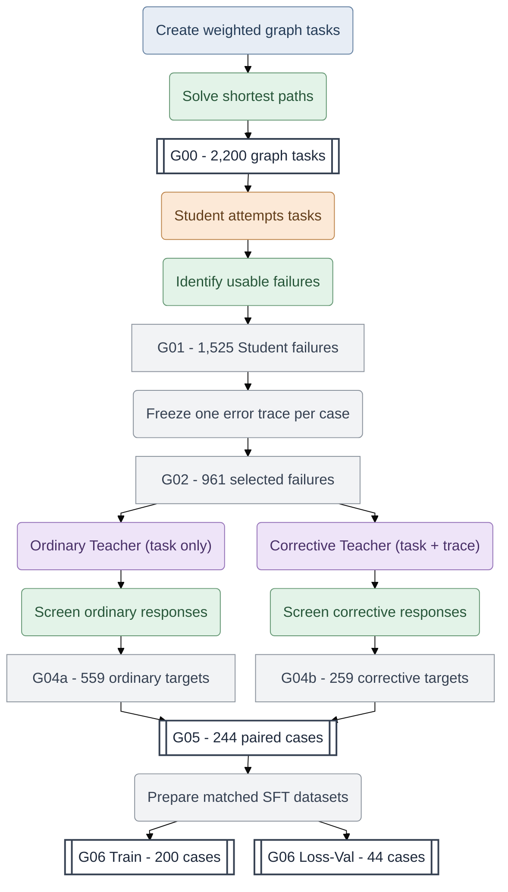
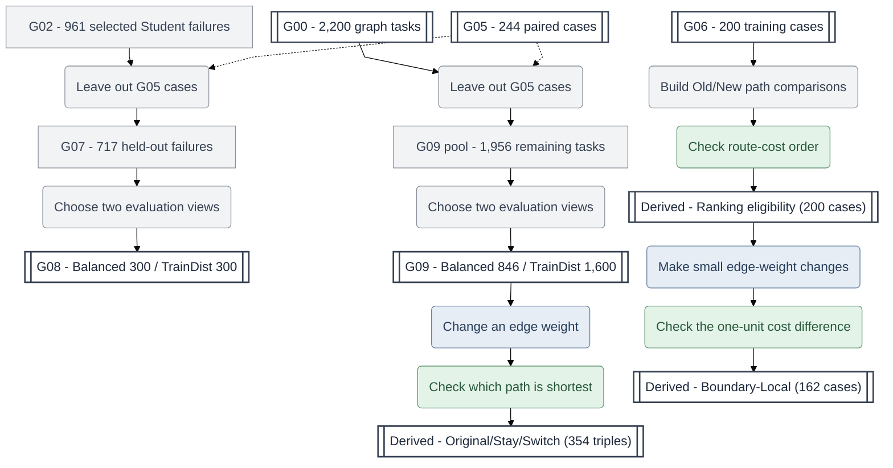
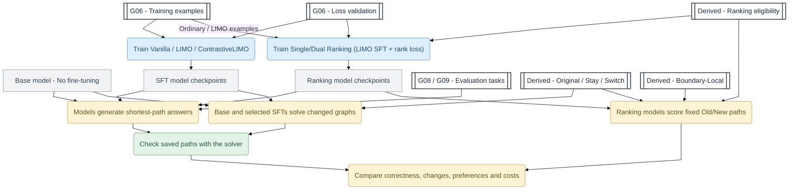

# PathFACT

**PathFACT: A Reusable Framework and Dataset for probing Failure-Informed LLM Reasoning**

**An LLM can give a convincing explanation and still get the answer wrong. Can LLMs learn more from mistakes than from correct examples alone?**

PathFACT helps researchers study this question. It combines **authentic Student failures**, **two forms of Teacher supervision**, and **answers checked by a deterministic solver**. Weighted shortest-path tasks are our testbed because they allow us to study LLM reasoning under controlled conditions, where correct outcomes can be verified, different types of errors can be distinguished, and changes to the problem can be measured objectively. Hence, they make several important aspects of LLM reasoning observable, measurable, and experimentally testable.

**Explore the resources:** [Dataset on Hugging Face](https://huggingface.co/datasets/MinervaCYY/PathFACT) | [Getting Started](GETTING_STARTED.md) | [Dataset Map](DATASET_MAP.md) | [Data Dictionary](DATA_DICTIONARY.md)

## Contents

- [1. Why use PathFACT?](#1-why-use-pathfact)
- [2. How PathFACT works](#2-how-pathfact-works)
  - [Step 1. Turn Student mistakes into paired Teacher examples](#step-1-turn-student-mistakes-into-paired-teacher-examples)
  - [Step 2. Prepare evaluation tasks and graph changes](#step-2-prepare-evaluation-tasks-and-graph-changes)
  - [Step 3. Train models and evaluate their decisions](#step-3-train-models-and-evaluate-their-decisions)
- [3. Published dataset releases](#3-published-dataset-releases)
- [4. What research questions can PathFACT help answer?](#4-what-research-questions-can-pathfact-help-answer)
- [5. Getting Started](#5-getting-started)
- [6. Guides and resources](#6-guides-and-resources)
- [7. Reproducibility, availability, and licensing](#7-reproducibility-availability-and-licensing)

## 1. Why use PathFACT?

PathFACT offers a reusable starting point for experiments that would otherwise require researchers to collect model failures, build corrective examples, and check results from scratch.

**PathFACT turns real LLM mistakes into reusable training data and test cases**. It connects actual failed attempts, Teacher-generated solutions, and mathematically verified answers, allowing researchers to investigate how different learning approaches affect a model's ability to solve problems.

- **Explore real LLM mistakes.** Examine shortest-path problems that a Student model actually failed to solve, including its submitted answers and recorded reasoning traces. These are genuine model failures, not artificially invented mistakes.

- **Compare different ways of learning.** Study three approaches on matched problems: learning from correct answers alone (*Vanilla-SFT*), learning from ordinary Teacher reasoning (*LIMO*), and learning from Teacher reasoning that explicitly addresses a recorded Student failure (*ContrastiveLIMO*). This helps investigate whether learning from mistakes offers benefits beyond conventional demonstrations.

- **Know whether a solution is actually correct.** Every shortest-path problem has a mathematically verifiable answer. Instead of relying on an LLM to judge another LLM, PathFACT uses a shortest-path solver to distinguish invalid routes, valid but more expensive routes, and minimum-cost routes.

- **Test whether models adapt when problems change.** What happens when the cost of a connection increases? Does the model recognise when the original best route remains optimal, or when another route becomes better? PathFACT provides controlled graph changes and candidate-route comparisons to investigate these questions.

- **Use the data and tools without specialised hardware.** Explore the released datasets, generate supported graph tasks, verify routes, and evaluate saved model predictions using the public CPU-only Python framework. Researchers can use their own model environments for new inference and training.

## 2. How PathFACT works

The workflow has three parts: **build supervision from model mistakes**, **prepare evaluation datasets**, and **train and evaluate models**. They connect through the named data stages, but not every stage is a published file.

In the diagrams, **coloured rounded boxes are actions**, **white double-bordered boxes are published datasets**, and **grey boxes are Python processing steps or intermediate records**. The action colours identify six roles: **grey-blue = Task Generator**, **orange = Student**, **purple = Teacher**, **green = Verifier**, **blue = Model Trainer**, and **yellow = Evaluator**.

### Step 1. Turn Student mistakes into paired Teacher examples

PathFACT starts with weighted shortest-path problems and solver-verified answers (G00). A Student model attempts the problems, and the recorded checks identify 1,525 usable failure cases (G01). From these, 961 cases are selected, each with one frozen incorrect Student reasoning trace (G02). The frozen trace is distinct from the Student's submitted final answer.

The Teacher produces two forms of candidate supervision. For **ordinary reasoning** (used by LIMO), the Teacher receives only the graph problem. For **corrective reasoning** (used by ContrastiveLIMO), the Teacher receives the same problem together with the frozen incorrect Student reasoning trace and corrective instructions. The recorded responses are checked separately (G04a/G04b), cases with accepted targets in both conditions are paired (G05), and matched supervised training and loss-validation resources are prepared (G06). The figure shows these conceptual operations rather than every historical data-consolidation step.



**How to read the figure:** G00 contains solver-labelled graph problems. G01 retains 1,525 cases with usable Student failures, and G02 selects 961 of these cases, freezing one incorrect Student reasoning trace per case. G04a and G04b retain accepted ordinary and corrective Teacher targets separately. **G05 is their intersection (244 cases), not the sum of 559 and 259.** G06 divides those same 244 case IDs into 200 training cases and 44 loss-validation cases. In the historical v0.1 files, each split has an ordinary file and a corrective file with matching case IDs; v0.2 adds an answer-only Vanilla-SFT file for each split. Loss validation measures training-target loss, not independent task-solving ability.

**Why was G03 needed?** The original Student and Teacher data were collected in multiple experimental runs, not one end-to-end batch. An earlier set of Teacher experiments was followed by additional experiments. When assembling the final canonical dataset, we therefore needed to determine which selected G02 failures could be reliably linked to the Teacher input or output records saved from those runs. **G03 was created to consolidate those batches and check their consistency.** It did not generate new Student failures or Teacher responses. It belongs between G02 and G04 in the frozen construction lineage, but is not drawn as an additional Teacher-generation action in this conceptual figure.

**What did G03 check?** The recorded G03 builder combined **546 previously filtered corrective-Teacher output records** from the earlier work with **412 prepared corrective-Teacher input records** from the later work. These were disjoint case-ID sets, but they were different kinds of records: the 546 were retained responses, while the 412 were prepared inputs. The builder checked that every case belonged to G02, that case IDs were not duplicated, and that the model-visible Teacher message contained the **exact incorrect Student reasoning trace frozen in G02**. It established coverage and trace consistency for **958 of the 961 G02 cases**. The other three cases lacked the required records but remain eligible for the G07 held-out candidate pool. The number 958 is **not** a count of completed Teacher attempts, accepted Teacher answers, or new model generations.

**How G04 differs from G03:** G03 checks whether records from separate research runs can be consistently connected to the selected Student failures. G04a and G04b instead select Teacher responses from recorded generations using the relevant acceptance procedures: **559 ordinary cases** and **259 corrective cases**, respectively. **G05 keeps the 244 cases that satisfy both conditions.** Some historical protocols generated multiple Teacher attempts per case, so neither G03 nor G04 counts should be read as an attempt count. G03 remains part of the frozen scientific records even though the figure focuses on the reusable Student–Teacher–Verifier method.

**Verification and reproducibility:** The solver checks the final route for feasibility and minimum cost, but these checks do not independently certify the entire reasoning trace. Among the 244 G05 pairs, **141 have additional recorded reasoning-factuality validation profiles for both Teacher targets**, while **103 have final-path checks only**. The published G06 filenames and some schema keys retain `gold` for the ordinary condition; these identifiers are kept unchanged for compatibility, although the research explanation uses **ordinary reasoning** for LIMO. G01–G04 are intermediate construction records, not additional standalone public JSONL datasets. See the [Dataset Map](DATASET_MAP.md), [Data Dictionary](DATA_DICTIONARY.md), and [Source Provenance](docs/SOURCE_PROVENANCE.md) for stage counts, validation scope, and historical lineage. The public CPU package does not run Student/Teacher inference or GPU training.

### Step 2. Prepare Evaluation Tasks and Test Changes in Graph Costs

After building training examples in Step 1, we want to investigate two questions: **Can a model solve shortest-path problems it was not trained on? And can it recognise when changing a link's cost changes which route is best?**

PathFACT provides evaluation tasks and controlled graph variations to investigate these questions. Their correct answers and route comparisons are determined by a shortest-path solver, rather than by another language model.

**1. Evaluate models on problems outside their training cases**

We prepare two groups of evaluation tasks:

- **G08 — Failure-focused evaluation:** Problems drawn from genuine Student failures that were not used to construct the paired training examples. It includes two 300-case evaluation sets.
- **G09 — Broader evaluation:** Problems drawn from the larger original task collection, excluding the paired supervision cases. It provides evaluation sets containing 846 and 1,600 cases.

These datasets let researchers compare performance on previously difficult problems and a broader range of shortest-path tasks. Training separation is based on case IDs; evaluation views can overlap and are not guaranteed to contain entirely different graph structures.

**2. What happens when the cost of a connection changes?**

Imagine a graph representing a network. A particular route is initially the shortest, but the cost of one connection changes. Should the model continue using the same route or choose another?

To investigate this, we construct three versions of the same graph:

- **Original:** The initial graph, with its original shortest route.
- **Stay:** The weight of one edge changes, but the selected original route is still optimal.
- **Switch:** The same edge's weight changes further, making the selected original route more expensive than a new shortest route.

Together, these three versions form a **counterfactual evaluation triple**. The nodes, connections, source, and destination stay the same; only one edge weight changes.

For example, in one released record, a direct connection between nodes 1 and 5 has a cost of 160 in Original. Its cost increases to 169 in Stay, where it remains optimal. When the cost reaches 171 in Switch, another route costing 170 becomes better.

PathFACT provides **354 such graph triples**, derived from selected G09 tasks. Researchers can test whether a model independently identifies the correct route under each condition.

**3. Can a model learn to prefer the better route?**

Finding a shortest path independently is different from choosing between two candidate routes.

For this purpose, we also construct **ranking comparisons** using the 200 G06 training cases. Each comparison considers two paths:

- **Old:** A shortest route in the original graph.
- **New:** An alternative route that becomes optimal after a suitable edge-weight change.

The solver calculates their costs under the original and changed graphs, establishing which route should be preferred. Among the 200 training cases, **162** support a strict preference for Old in Original and New in Switch; **9** have equally good routes in Original but a strict preference for New in Switch; and **29** have no qualifying strict Switch comparison.

These records support research on whether teaching a model to prefer better candidate paths also improves its ability to generate optimal paths independently.

**4. How small a change can reverse the best route?**

For the 162 strict ranking cases, PathFACT provides an additional **Boundary-Local** dataset. It identifies an edge weight at which the two candidate routes would have equal costs, then constructs graph variants immediately on opposite sides of that threshold.

On one side, Old is better by one cost unit. On the other, New is better by one cost unit. This creates controlled examples for studying decisions near the point where the preferred route changes.

**What the released data contain:** These derived datasets store graph variations, candidate paths, solver-calculated costs, and verified comparisons. They do **not** contain model-generated answers, learned preference scores, or claims that a model successfully adapted. Researchers can use the public CPU tools to inspect and verify the graph relationships, while new model inference and model-dependent preference scoring require their own model environments.



**Two evaluation populations:** G07 is `G02 minus G05` (717 failures). G08 publishes two disjoint 300-case views; another 117 cases form an unpublished reserve. The G09 pool is `G00 minus G05` (1,956 tasks), from which the 846-case Balanced and 1,600-case TrainDist views are drawn. **The G09 views overlap, and G08/G09 can also overlap.** Across all four public views, there are 3,046 row memberships but 1,859 distinct case IDs. These are not independent repeats of the same-size test population.

**Two different uses for changed graphs:** The 354 Original/Stay/Switch triples come from selected G09 cases and are used to test responses to changed tasks. The 200 G06 ranking-eligibility records instead describe whether the original and modified graphs support a strict Old/New route preference: **162** strict in both directions, **9** tied on Original but strict on Switch, and **29** with no qualifying strict Switch. The 162 Boundary-Local records support a separate, training-related analysis of small cost changes. The released Derived files contain graph-based labels, **not model outputs or learned preference scores**.


### Step 3. Train Models and Evaluate What They Have Learned

After preparing the training examples in Step 1 and the evaluation datasets in Step 2, we investigate a central question: **Does learning from real mistakes help a language model solve new shortest-path problems, or does it simply change how the model responds to examples it has already seen?**

We compare several training methods and evaluate their behaviour using mathematically verified shortest-path tasks.

**1. What do the different training methods teach?**

We start with the same base model and investigate different forms of supervision:

- **Base — No additional training.** The original model provides a reference for measuring the effects of fine-tuning.

- **Vanilla-SFT — Learn from correct answers.** The model learns from graph problems paired with their correct shortest-path answers, without Teacher-generated reasoning.

- **LIMO — Learn from correct reasoning.** The model learns from ordinary Teacher-generated reasoning that explains how to solve a shortest-path problem and provides the correct answer.

- **ContrastiveLIMO — Learn from real mistakes.** The model learns from examples containing an actual Student reasoning failure and a Teacher response that addresses the mistake and provides a correct solution. Unlike LIMO, the Teacher's reasoning is explicitly conditioned on the Student's recorded error.

The key comparison is whether **learning how to correct a real mistake** offers benefits beyond learning from correct answers or ordinary reasoning demonstrations.

**Single-Ranking and Dual-Ranking** investigate a different idea: can teaching a model to prefer better candidate routes improve its ability to find shortest paths?

Both ranking conditions retain LIMO-style supervised fine-tuning and introduce an additional ranking objective:

- **Single-Ranking:** Encourages the model to prefer the new shortest route over the old route when a changed edge weight makes the new route better (Switch).
- **Dual-Ranking:** Also encourages the reverse preference on the original graph when the old route is strictly better, alongside the Switch preference. When the original routes tie, only the applicable Switch ranking objective is used.

These are separate training runs starting from the same base model, not additional fine-tuning of an already trained LIMO checkpoint.




**2. How do we find out what the models actually learned?**

We use three complementary evaluation approaches.

- **Test independent problem solving.** Give the model a shortest-path problem from G08 or G09, without showing the correct route or any candidate answers. The model must generate its own solution. We then use the solver to determine whether the resulting route is invalid, valid but more expensive than necessary, or optimal. This directly measures the model's ability to solve the task independently.

- **Test responses to changing graphs.** Present the Original, Stay, and Switch versions of a graph as three separate shortest-path problems. The model must solve each version independently. We examine whether it continues to find an optimal route when the original best route remains valid (Stay) and when a different route becomes better (Switch). This tests the model's behaviour under controlled changes in edge costs.

- **Test preferences between candidate routes.** Instead of asking the model to generate a route, evaluate how strongly it favours two predefined answers: Old and New. We calculate the model's likelihood score for each candidate answer under the relevant graph problem, then compare its preference with the solver-established route-cost ordering. This reveals whether the model assigns a stronger preference to the better candidate. **Preferring the correct answer when candidates are supplied is not the same as generating that answer independently.**

For the main independent-solving evaluations, models receive only the graph task. **ContrastiveLIMO does not require a Student error trace at evaluation time**, even though those traces were used to construct its corrective training examples.

**3. What have the completed experiments shown?**

The completed investigation compares ordinary answer supervision, reasoning-based supervision, corrective supervision, and additional ranking objectives. It examines shortest-path correctness, improvements and regressions on individual problems, sensitivity to training settings, responses to changed edge weights, and computational costs.

One important finding is that **better candidate-route preferences do not necessarily translate into better independent problem solving**. The completed Single- and Dual-Ranking experiments did not consistently improve task-only G08/G09 shortest-path performance over LIMO.

The Boundary-Local resources support completed preference-related analyses near route-optimality changes. They do not establish a completed independent shortest-path generation result for Boundary-Local tasks.

**4. What can researchers run with the public software?**

The workflow diagrams distinguish released datasets from model-dependent operations. White double-bordered boxes represent released data resources.

The public **CPU-only PathFACT package** supports documented graph generation and verification, dataset processing, construction of supported derived resources, and evaluation of previously saved model predictions.

Researchers provide their own environments for Student and Teacher inference, fine-tuning, new model generation, and candidate-answer likelihood scoring. The CPU package does not perform these model-dependent operations.

Finally, **a solver-verified optimal answer does not automatically mean that every sentence in the model's reasoning is correct**. PathFACT distinguishes final-answer verification from the additional reasoning checks recorded for some supervision examples.


## 3. Published dataset releases

The current PathFACT v0.2 release contains **12 Core and 3 Derived JSONL
resources (15 total)**. It preserves all 13 scientific JSONL resources from
v0.1 and adds two Vanilla-SFT files. The v0.1 counts and filenames below are
historical; v0.2 does not replace or rewrite those resources.

### SFT methods and dataset identifiers

| Method | Dataset identifier | G06 files | Supervision |
|---|---|---|---|
| **Vanilla-SFT** | Filename prefix `answer_only`; generated-record condition `vanilla` | `answer_only_train_200_prompt_completion_v1.jsonl`; `answer_only_loss_val_44_prompt_completion_v1.jsonl` | Final answer only, without Teacher reasoning. |
| **LIMO** | `gold` | `gold_train_200_prompt_completion_v1.jsonl`; `gold_loss_val_44_prompt_completion_v1.jsonl` | Ordinary Teacher reasoning and verified answer. |
| **ContrastiveLIMO** | `contrastive` | `contrastive_train_200_prompt_completion_v1.jsonl`; `contrastive_loss_val_44_prompt_completion_v1.jsonl` | Failure-conditioned corrective Teacher reasoning and verified answer. |

The Hub configuration identifiers remain `g06_vanilla_train_200`,
`g06_vanilla_loss_val_44`, `g06_gold_train_200`,
`g06_gold_loss_val_44`, `g06_contrastive_train_200`, and
`g06_contrastive_loss_val_44`. `Gold` and `Contrastive` describe supervision
conditions; LIMO and ContrastiveLIMO are the method names. The historical
`answer_only` filename prefix and `vanilla` condition value are retained.

### Historical v0.1 release contents

| Resource | What you get | Why it matters |
|---|---|---|
| **CPU Python framework (C1)** | Configurable graph/task tools, shortest-path solver and route checks, supported data builders/exporters, and saved-prediction scoring | Reuse data and verification steps without the original GPU/HPC environment |
| **Core datasets (C2)** | 2,200 G00 tasks; 244 G05 paired failures and Teacher targets; four G06 Teacher-reasoning files; four G08/G09 evaluation views | Work from authentic failures, matched supervision, and known test inputs |
| **Derived datasets (C2)** | 354 counterfactual triples; 200 ranking-eligibility records; 162 Boundary-Local records | Study graph changes and answer-level preferences with solver-derived labels |
| **Completed experiments (C3)** | SFT comparisons, graph-change tests, Single/Dual Ranking comparisons, and saved evaluation evidence described in project guides | Investigate what training and preference learning do, including where they do not help |

The historical v0.1 suite contained **10 Core and 3 Derived JSONL files**.
The current v0.2 suite contains **12 Core and 3 Derived**. The dataset is a
**standalone research contribution**, not merely a demo for the Python
package. Browse the [Dataset Map](DATASET_MAP.md) for all 15 current files
and their relationships, and the [Data Dictionary](DATA_DICTIONARY.md) for
exact fields and validation limits.

## 4. What research questions can PathFACT help answer?

PathFACT is designed for studies of LLM reasoning that can be checked against an exact answer:

- **Learning from mistakes:** Do failure-guided examples change autonomous problem-solving compared with ordinary demonstrations?
- **Reasoning versus answers:** Can a model produce a plausible explanation but still choose an invalid or longer route?
- **Robustness to changes:** Does the model respond appropriately when a single graph edge weight changes?
- **Preference versus generation:** Does learning to rank a correct candidate higher translate into generating the correct answer on its own?
- **Practical evaluation:** How do task selection, answer extraction, checkpoint choice, and compute costs affect the interpretation of results?

The completed investigation includes Base, Vanilla-SFT, LIMO, ContrastiveLIMO, and the LIMO-based Single/Dual Ranking conditions. Its results are specific to the recorded models, tasks, and training recipes; PathFACT does **not** claim universal improvements or demonstrated transfer to other reasoning domains. See [Offline Evaluation](docs/EVALUATION.md) for scoring rules and limitations.

## 5. Getting Started

The public package requires **Python 3.12 or newer** and runs in a CPU-only environment:

```bash
python3.12 -m venv .venv
source .venv/bin/activate
python -m pip install -e .
```

Inspect the supported commands:

```bash
pathfact --help
pathfact path verify --help
pathfact dataset build-paired-sft --help
pathfact dataset export-public --help
pathfact dataset export-core-candidate --help
pathfact dataset export-derived-candidate --help
pathfact evaluate saved --help
```

Start with the [Getting Started guide](GETTING_STARTED.md) for a worked record and instructions for keeping model inputs separate from solver references. Dataset builders require input records supplied by the researcher, and `pathfact evaluate saved` consumes **already extracted paths**, not model outputs generated by the package. You can inspect and use the released datasets without running the original Student/Teacher generation or model training.

## 6. Guides and resources

- [Getting Started](GETTING_STARTED.md) - first example and model/reference fields.
- [Dataset Map](DATASET_MAP.md) - all 15 v0.2 JSONL files, counts, stages, and overlaps.
- [Data Dictionary](DATA_DICTIONARY.md) - dataset fields and validation caveats.
- [Offline Evaluation](docs/EVALUATION.md) - inputs, scoring policies, outputs, and limitations.
- [Source Provenance](docs/SOURCE_PROVENANCE.md) - verified source history and reproducibility evidence.
- [Dataset Licensing](docs/DATASET_LICENSE.md) - licence scope and exclusions.
- [Hugging Face Dataset Card](https://huggingface.co/datasets/MinervaCYY/PathFACT) - published dataset files and release disclosures.

## 7. Reproducibility, availability, and licensing

The historical v0.1 scientific release is preserved at [revision `3d20d452e1efe21c80d55185f5176ca3fc5e4f9f`](https://huggingface.co/datasets/MinervaCYY/PathFACT/tree/3d20d452e1efe21c80d55185f5176ca3fc5e4f9f). The current v0.2 release contains 15 scientific JSONL resources; its two Vanilla-SFT files are additive. The public CPU-only framework does not provide Student/Teacher LLM inference or model training: researchers supply their own model environments for those operations. The current dataset card documents the release scope, licensing, and provenance.

The software is licensed under **MIT**. The dataset has a **limited CC BY 4.0 scope**, with third-party exclusions described in the [Dataset Card](https://huggingface.co/datasets/MinervaCYY/PathFACT) and [Dataset Licensing](docs/DATASET_LICENSE.md). The software licence does not automatically grant rights to dataset content.

The original model training, Student/Teacher inference, new model generations, and candidate-answer likelihood scoring require researcher-managed environments. The public CPU package does not supply those model environments, historical checkpoints, or all saved experimental outputs. The implemented software and the frozen scientific research records should not be confused: consult [Source Provenance](docs/SOURCE_PROVENANCE.md) and the linked guides for verified scope and limitations.
