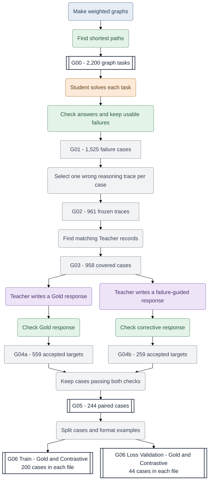
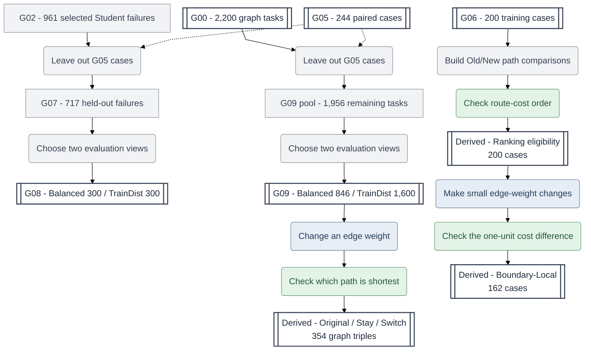
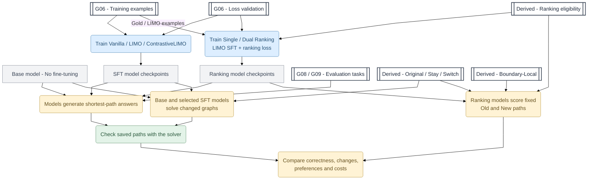

# PathFACT

**PathFACT: A Reusable Framework and Dataset for probing Failure-Informed LLM Reasoning**

**An LLM can give a convincing explanation and still get the answer wrong. Can LLM learn more from its mistakes than from correct examples alone?**

PathFACT helps researchers study this question. It combines **real model failures**, **two forms of Teacher supervision**, **answers checked by a deterministic solver**.
Weighted shortest-path tasks are our testbed because they allow us to study LLM reasoning under controlled conditions, where correct outcomes can be verified, different types of errors can be distinguished, and changes to the problem can be measured objectively. Hence, they make several important aspects of LLM reasoning observable, measurable, and experimentally testable.

**Explore the resources:** [Dataset on Hugging Face](https://huggingface.co/datasets/MinervaCYY/PathFACT) | [Getting Started](GETTING_STARTED.md) | [Dataset Map](DATASET_MAP.md) | [Data Dictionary](DATA_DICTIONARY.md)

## 1. Why use PathFACT?

PathFACT offers a reusable starting point for experiments that would otherwise require researchers to collect model failures, build corrective examples, and check results from scratch.

- **Study real mistakes.** Inspect selected wrong Student answers and frozen reasoning traces, rather than relying only on synthetic errors or correct demonstrations.
- **Compare how models are taught.** Use matched Gold and failure-guided Contrastive examples to test different supervision methods on the same problems.
- **Check answers objectively.** Distinguish invalid paths, valid but longer paths, and minimum-cost paths using solver references.
- **Test changes, not just static questions.** Use Original/Stay/Switch graphs and Old/New path pairs to study whether model decisions respond to changed edge weights.
- **Work with data on a CPU.** Install the public Python package to prepare supported data, check paths, and score saved predictions. Bring your own model environment for inference or training.

The **v0.1 dataset suite** contains **13 JSONL files: 10 Core and 3 Derived**. 

## 2. How PathFACT works

The workflow has three parts: **build supervision from model mistakes**, **prepare evaluation datasets**, and **train and evaluate models**. They connect through the named data stages, but not every stage is a published file.

In the diagrams, **coloured rounded boxes are actions**, **white double-bordered boxes are published datasets**, and **grey boxes are Python processing steps or intermediate records**. The action colours identify six roles: **grey-blue = Task Generator**, **orange = Student**, **purple = Teacher**, **green = Verifier**, **blue = Model Trainer**, and **yellow = Evaluator**.

### Step 1. Turn Student mistakes into paired Teacher examples

First, generate shortest-path problems and compute their correct answers. Ask a Student model to solve them, then keep usable failures and select one frozen wrong reasoning trace per case. A Teacher produces ordinary **Gold** supervision and **failure-guided Contrastive** supervision in parallel. Recorded checks determine which targets can be paired.



**What the numbers mean:** G01 contains 1,525 usable Student failure cases. G02 keeps 961 cases, each with one frozen wrong reasoning trace. G03 records Teacher-entry coverage for 958 cases. The Gold and Contrastive branches accept 559 and 259 targets respectively; **244 cases pass both gates**. Those 244 cases become 200 training cases and 44 separate loss-validation cases, with a Gold and Contrastive file for each split. The two supervision formats use **the same case IDs**. Loss validation monitors training; it is not a task-only evaluation set.

**What is checked:** A solver can verify the final route and its cost. Teacher acceptance also uses documented, branch-specific checks; it does **not** mean every sentence of every Teacher reasoning trace has been independently certified. The frozen Student reasoning trace and its submitted final answer are separate fields; the Contrastive training prompt uses the trace, not necessarily the full submitted final answer. Three G02 cases have no recorded Teacher-entry coverage, but remain in the G07 held-out pool. In G05, 141 paired records carry additional reasoning-factuality profiles, while 103 have final-path checks only. G01-G04 are intermediate selection stages, not extra standalone public JSONL files.

### Step 2. Prepare evaluation tasks and graph changes

Evaluation datasets come from earlier task records, **not from a newly trained model**. G08 focuses on cases where the original Student failed. G09 draws from a broader set of tasks. Separate Python operations also create two types of graph-change resources: **counterfactual evaluation triples from G09** and **ranking comparisons from G06 training cases**.



**Two evaluation populations:** G07 is `G02 minus G05` (717 failures). G08 publishes two disjoint 300-case views; another 117 cases form an unpublished reserve. The G09 pool is `G00 minus G05` (1,956 tasks), from which the 846-case Balanced and 1,600-case TrainDist views are drawn. **The G09 views overlap, and G08/G09 can also overlap.** Across all four public views, there are 3,046 row memberships but 1,859 distinct case IDs. These are not independent repeats of the same-size test population.

**Two different uses for changed graphs:** The 354 Original/Stay/Switch triples come from selected G09 cases and are used to test responses to changed tasks. The 200 G06 ranking-eligibility records instead describe whether the original and modified graphs support a strict Old/New route preference: **162** strict in both directions, **9** tied on Original but strict on Switch, and **29** with no qualifying strict Switch. The 162 Boundary-Local records support a separate, training-related analysis of small cost changes. The released Derived files contain graph-based labels, **not model outputs or learned preference scores**.

### Step 3. Train models and evaluate their decisions

Researchers can use the released resources to compare **answer-only supervision, ordinary Teacher reasoning, failure-guided correction, and ranking-based training**. Model inference, training, and candidate likelihood scoring run in the researcher's own model environment. After inference, the public CPU tools can score saved, extracted paths.



**Three ways to evaluate a model:**

1. **Generate an answer.** Give the model a new G08/G09 task, without the reference answer. Check whether its route is valid and shortest.
2. **Solve a changed problem.** Ask the model to solve the Original, Stay, and Switch graphs independently. Compare how its answers change when an edge weight changes.
3. **Score two supplied answers.** Give a ranking model a fixed Old/New candidate pair. Compare its answer-token likelihood preference with the true route-cost order. This is **not** the same as generating a path without candidates.

**Training methods:** Vanilla uses correct-answer-only targets; LIMO uses ordinary Gold Teacher reasoning; ContrastiveLIMO uses failure-guided corrective reasoning. **Single- and Dual-Ranking are separate LIMO-based training runs**, not further fine-tuning of an existing LIMO checkpoint. Single adds Switch-answer preferences; Dual adds Original and Switch preferences when eligible. The completed experiments did not find a consistent gain in independent G08/G09 solving from the ranking losses. Boundary-Local has completed preference-related analyses, **not** a completed task-only G08/G09 result.

**What the software does:** White boxes identify released data resources, while the training and generation actions require external model environments. The public CPU package supports the documented graph/solver operations, data processing, derived-resource handling, and **scoring of saved predictions**. It does not perform Student/Teacher inference, GPU training, new model generation, or model-dependent candidate-answer NLL scoring. Final-path verification does not certify every sentence of a reasoning trace.

## 3. What is included in v0.1?

| Resource | What you get | Why it matters |
|---|---|---|
| **CPU Python framework (C1)** | Configurable graph/task tools, shortest-path solver and route checks, supported data builders/exporters, and saved-prediction scoring | Reuse data and verification steps without the original GPU/HPC environment |
| **Core datasets (C2)** | 2,200 G00 tasks; 244 G05 paired failures and Teacher targets; four G06 files; four G08/G09 evaluation views | Work from authentic failures, matched supervision, and known test inputs |
| **Derived datasets (C2)** | 354 counterfactual triples; 200 ranking-eligibility records; 162 Boundary-Local records | Study graph changes and answer-level preferences with solver-derived labels |
| **Completed experiments (C3)** | SFT comparisons, graph-change tests, Single/Dual Ranking comparisons, and saved evaluation evidence described in project guides | Investigate what training and preference learning do, including where they do not help |

The data is a **standalone research contribution**, not merely a demo for the Python package. Browse the [Dataset Map](DATASET_MAP.md) for the 13 files and their relationships, and the [Data Dictionary](DATA_DICTIONARY.md) for exact fields and validation limits.

## 4. What research questions can PathFACT help answer?

PathFACT is designed for studies of LLM reasoning that can be checked against an exact answer:

- **Learning from mistakes:** Do failure-guided examples change autonomous problem-solving compared with ordinary demonstrations?
- **Reasoning versus answers:** Can a model produce a plausible explanation but still choose an invalid or longer route?
- **Robustness to changes:** Does the model respond appropriately when a single graph edge weight changes?
- **Preference versus generation:** Does learning to rank a correct candidate higher translate into generating the correct answer on its own?
- **Practical evaluation:** How do task selection, answer extraction, checkpoint choice, and compute costs affect the interpretation of results?

The completed investigation includes Base, Vanilla-SFT, LIMO, ContrastiveLIMO, and the LIMO-based Single/Dual Ranking conditions. Its results are specific to the recorded models, tasks, and training recipes; PathFACT does **not** claim universal improvements or demonstrated transfer to other reasoning domains. See [Offline Evaluation](docs/EVALUATION.md) for scoring rules and limitations.

## 5. Getting Started

The public package requires **Python 3.12 or newer** and runs in a CPU-only environment:

```bash
python3.12 -m venv .venv
source .venv/bin/activate
python -m pip install -e .
```

Inspect the supported commands:

```bash
pathfact --help
pathfact path verify --help
pathfact dataset build-paired-sft --help
pathfact dataset export-public --help
pathfact dataset export-core-candidate --help
pathfact dataset export-derived-candidate --help
pathfact evaluate saved --help
```

Start with the [Getting Started guide](GETTING_STARTED.md) for a worked record and instructions for keeping model inputs separate from solver references. Dataset builders require input records supplied by the researcher, and `pathfact evaluate saved` consumes **already extracted paths**, not model outputs generated by the package. You can inspect and use the released datasets without running the original Student/Teacher generation or model training.

## 6. Guides and resources

- [Getting Started](GETTING_STARTED.md) - first example and model/reference fields.
- [Dataset Map](DATASET_MAP.md) - all 13 JSONL files, counts, stages, and overlaps.
- [Data Dictionary](DATA_DICTIONARY.md) - dataset fields and validation caveats.
- [Offline Evaluation](docs/EVALUATION.md) - inputs, scoring policies, outputs, and limitations.
- [Source Provenance](docs/SOURCE_PROVENANCE.md) - verified source history and reproducibility evidence.
- [Dataset Licensing](docs/DATASET_LICENSE.md) - licence scope and exclusions.
- [Hugging Face Dataset Card](https://huggingface.co/datasets/MinervaCYY/PathFACT) - published dataset files and release disclosures.

## 7. Reproducibility, availability, and licensing

The frozen scientific dataset release is [PathFACT v0.1 at revision `3d20d452e1efe21c80d55185f5176ca3fc5e4f9f`](https://huggingface.co/datasets/MinervaCYY/PathFACT/tree/3d20d452e1efe21c80d55185f5176ca3fc5e4f9f). Documentation updates do not change the 13 scientific JSONL resources in that release.

The software is licensed under **MIT**. The dataset has a **limited CC BY 4.0 scope**, with third-party exclusions described in the [Dataset Card](https://huggingface.co/datasets/MinervaCYY/PathFACT) and [Dataset Licensing](docs/DATASET_LICENSE.md). The software licence does not automatically grant rights to dataset content.

The original model training, Student/Teacher inference, new model generations, and candidate-answer likelihood scoring require researcher-managed environments. The public CPU package does not supply those model environments, historical checkpoints, or all saved experimental outputs. The implemented software and the frozen scientific research records should not be confused: consult [Source Provenance](docs/SOURCE_PROVENANCE.md) and the linked guides for verified scope and limitations.
