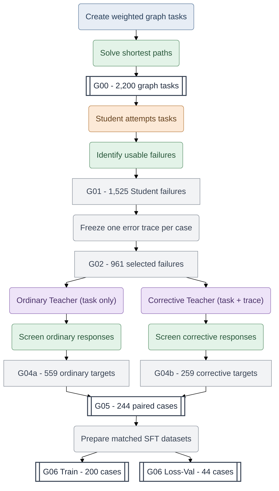
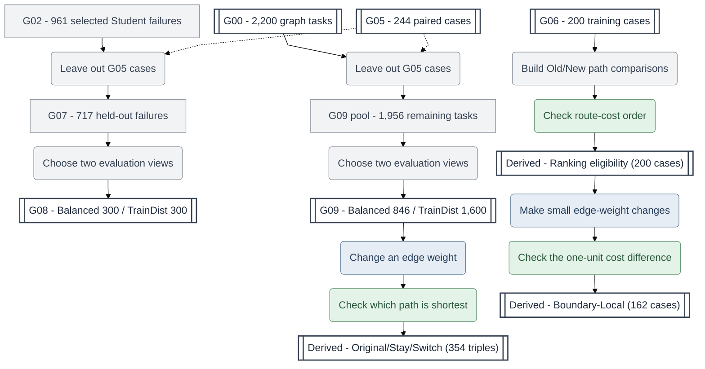
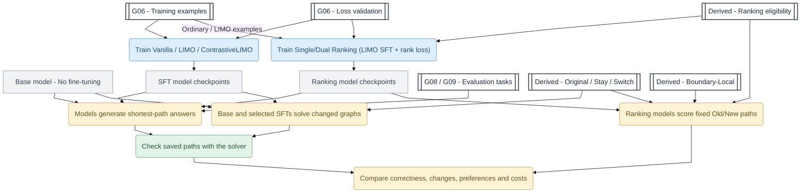

# PathFACT

**PathFACT: A Reusable Framework and Dataset for probing Failure-Informed LLM Reasoning**

**An LLM can give a convincing explanation and still get the answer wrong. Can LLMs learn more from mistakes than from correct examples alone?**

PathFACT helps researchers study this question. It combines **authentic Student failures**, **two forms of Teacher supervision**, and **answers checked by a deterministic solver**. Weighted shortest-path tasks are our testbed because they allow us to study LLM reasoning under controlled conditions, where correct outcomes can be verified, different types of errors can be distinguished, and changes to the problem can be measured objectively. Hence, they make several important aspects of LLM reasoning observable, measurable, and experimentally testable.

**Explore the resources:** [Dataset on Hugging Face](https://huggingface.co/datasets/MinervaCYY/PathFACT) | [Getting Started](GETTING_STARTED.md) | [Dataset Map](DATASET_MAP.md) | [Data Dictionary](DATA_DICTIONARY.md)

## Contents

- [1. Why use PathFACT?](#1-why-use-pathfact)
- [2. How PathFACT works](#2-how-pathfact-works)
  - [Step 1. Turn Student mistakes into paired Teacher examples](#step-1-turn-student-mistakes-into-paired-teacher-examples)
  - [Step 2. Prepare evaluation tasks and graph changes](#step-2-prepare-evaluation-tasks-and-graph-changes)
  - [Step 3. Train models and evaluate their decisions](#step-3-train-models-and-evaluate-their-decisions)
- [3. What is included in v0.1?](#3-what-is-included-in-v01)
- [4. What research questions can PathFACT help answer?](#4-what-research-questions-can-pathfact-help-answer)
- [5. Getting Started](#5-getting-started)
- [6. Guides and resources](#6-guides-and-resources)
- [7. Reproducibility, availability, and licensing](#7-reproducibility-availability-and-licensing)

## 1. Why use PathFACT?

PathFACT offers a reusable starting point for experiments that would otherwise require researchers to collect model failures, build corrective examples, and check results from scratch.

- **Study real mistakes.** Inspect selected wrong Student answers and frozen reasoning traces, rather than relying only on synthetic errors or correct demonstrations.
- **Compare how models are taught.** Use matched ordinary and failure-guided corrective Teacher examples to compare supervision methods on the same problems.
- **Check answers objectively.** Distinguish invalid paths, valid but longer paths, and minimum-cost paths using solver references.
- **Test changes, not just static questions.** Use Original/Stay/Switch graphs and Old/New path pairs to study whether model decisions respond to changed edge weights.
- **Work with data on a CPU.** Install the public Python package to prepare supported data, check paths, and score saved predictions. Bring your own model environment for inference or training.

## 2. How PathFACT works

The workflow has three parts: **build supervision from model mistakes**, **prepare evaluation datasets**, and **train and evaluate models**. They connect through the named data stages, but not every stage is a published file.

In the diagrams, **coloured rounded boxes are actions**, **white double-bordered boxes are published datasets**, and **grey boxes are Python processing steps or intermediate records**. The action colours identify six roles: **grey-blue = Task Generator**, **orange = Student**, **purple = Teacher**, **green = Verifier**, **blue = Model Trainer**, and **yellow = Evaluator**.

### Step 1. Turn Student mistakes into paired Teacher examples

PathFACT starts with weighted shortest-path problems and solver-verified answers (G00). A Student model attempts the problems, and the recorded checks identify 1,525 usable failure cases (G01). From these, 961 cases are selected, each with one frozen incorrect Student reasoning trace (G02). The frozen trace is distinct from the Student's submitted final answer.

The Teacher produces two forms of candidate supervision. For **ordinary reasoning** (used by LIMO), the Teacher receives only the graph problem. For **corrective reasoning** (used by ContrastiveLIMO), the Teacher receives the same problem together with the frozen incorrect Student reasoning trace and corrective instructions. The recorded responses are checked separately (G04a/G04b), cases with accepted targets in both conditions are paired (G05), and matched supervised training and loss-validation resources are prepared (G06). The figure shows these conceptual operations rather than every historical data-consolidation step.



**How to read the figure:** G00 contains solver-labelled graph problems. G01 retains 1,525 cases with usable Student failures, and G02 selects 961 of these cases, freezing one incorrect Student reasoning trace per case. G04a and G04b retain accepted ordinary and corrective Teacher targets separately. **G05 is their intersection (244 cases), not the sum of 559 and 259.** G06 divides those same 244 case IDs into 200 training cases and 44 loss-validation cases. Each split has an ordinary file and a corrective file, with matching case IDs. Loss validation measures training-target loss, not independent task-solving ability.

**Why was G03 needed?** The original Student and Teacher data were collected in multiple experimental runs, not one end-to-end batch. An earlier set of Teacher experiments was followed by additional experiments. When assembling the final canonical dataset, we therefore needed to determine which selected G02 failures could be reliably linked to the Teacher input or output records saved from those runs. **G03 was created to consolidate those batches and check their consistency.** It did not generate new Student failures or Teacher responses. It belongs between G02 and G04 in the frozen construction lineage, but is not drawn as an additional Teacher-generation action in this conceptual figure.

**What did G03 check?** The recorded G03 builder combined **546 previously filtered corrective-Teacher output records** from the earlier work with **412 prepared corrective-Teacher input records** from the later work. These were disjoint case-ID sets, but they were different kinds of records: the 546 were retained responses, while the 412 were prepared inputs. The builder checked that every case belonged to G02, that case IDs were not duplicated, and that the model-visible Teacher message contained the **exact incorrect Student reasoning trace frozen in G02**. It established coverage and trace consistency for **958 of the 961 G02 cases**. The other three cases lacked the required records but remain eligible for the G07 held-out candidate pool. The number 958 is **not** a count of completed Teacher attempts, accepted Teacher answers, or new model generations.

**How G04 differs from G03:** G03 checks whether records from separate research runs can be consistently connected to the selected Student failures. G04a and G04b instead select Teacher responses from recorded generations using the relevant acceptance procedures: **559 ordinary cases** and **259 corrective cases**, respectively. **G05 keeps the 244 cases that satisfy both conditions.** Some historical protocols generated multiple Teacher attempts per case, so neither G03 nor G04 counts should be read as an attempt count. G03 remains part of the frozen scientific records even though the figure focuses on the reusable Student–Teacher–Verifier method.

**Verification and reproducibility:** The solver checks the final route for feasibility and minimum cost, but these checks do not independently certify the entire reasoning trace. Among the 244 G05 pairs, **141 have additional recorded reasoning-factuality validation profiles for both Teacher targets**, while **103 have final-path checks only**. The published G06 filenames and some schema keys retain `gold` for the ordinary condition; these identifiers are kept unchanged for compatibility, although the research explanation uses **ordinary reasoning** for LIMO. G01–G04 are intermediate construction records, not additional standalone public JSONL datasets. See the [Dataset Map](DATASET_MAP.md), [Data Dictionary](DATA_DICTIONARY.md), and [Source Provenance](docs/SOURCE_PROVENANCE.md) for stage counts, validation scope, and historical lineage. The public CPU package does not run Student/Teacher inference or GPU training.

### Step 2. Prepare evaluation tasks and graph changes

Evaluation datasets come from earlier task records, **not from a newly trained model**. G08 focuses on cases where the original Student failed. G09 draws from a broader set of tasks. Separate Python operations also create two types of graph-change resources: **counterfactual evaluation triples from G09** and **ranking comparisons from G06 training cases**.



**Two evaluation populations:** G07 is `G02 minus G05` (717 failures). G08 publishes two disjoint 300-case views; another 117 cases form an unpublished reserve. The G09 pool is `G00 minus G05` (1,956 tasks), from which the 846-case Balanced and 1,600-case TrainDist views are drawn. **The G09 views overlap, and G08/G09 can also overlap.** Across all four public views, there are 3,046 row memberships but 1,859 distinct case IDs. These are not independent repeats of the same-size test population.

**Two different uses for changed graphs:** The 354 Original/Stay/Switch triples come from selected G09 cases and are used to test responses to changed tasks. The 200 G06 ranking-eligibility records instead describe whether the original and modified graphs support a strict Old/New route preference: **162** strict in both directions, **9** tied on Original but strict on Switch, and **29** with no qualifying strict Switch. The 162 Boundary-Local records support a separate, training-related analysis of small cost changes. The released Derived files contain graph-based labels, **not model outputs or learned preference scores**.

### Step 3. Train models and evaluate their decisions

Researchers can use the released resources to compare **answer-only supervision, ordinary Teacher reasoning, failure-guided correction, and ranking-based training**. Model inference, training, and candidate likelihood scoring run in the researcher's own model environment. After inference, the public CPU tools can score saved, extracted paths.



**Three ways to evaluate a model:**

1. **Generate an answer.** Give the model a new G08/G09 task, without the reference answer. Check whether its route is valid and shortest.
2. **Solve a changed problem.** Ask the model to solve the Original, Stay, and Switch graphs independently. Compare how its answers change when an edge weight changes.
3. **Score two supplied answers.** Give a ranking model a fixed Old/New candidate pair. Compare its answer-token likelihood preference with the true route-cost order. This is **not** the same as generating a path without candidates.

**Training methods:** Vanilla uses correct-answer-only targets; LIMO uses ordinary Teacher reasoning; ContrastiveLIMO uses failure-guided corrective reasoning. **Single- and Dual-Ranking are separate LIMO-based training runs**, not further fine-tuning of an existing LIMO checkpoint. Single adds Switch-answer preferences; Dual adds Original and Switch preferences when eligible. The completed experiments did not find a consistent gain in independent G08/G09 solving from the ranking losses. Boundary-Local has completed preference-related analyses, **not** a completed task-only G08/G09 result.

**What the software does:** White boxes identify released data resources, while the training and generation actions require external model environments. The public CPU package supports the documented graph/solver operations, data processing, derived-resource handling, and **scoring of saved predictions**. It does not perform Student/Teacher inference, GPU training, new model generation, or model-dependent candidate-answer NLL scoring. Final-path verification does not certify every sentence of a reasoning trace.

## 3. What is included in v0.1?

| Resource | What you get | Why it matters |
|---|---|---|
| **CPU Python framework (C1)** | Configurable graph/task tools, shortest-path solver and route checks, supported data builders/exporters, and saved-prediction scoring | Reuse data and verification steps without the original GPU/HPC environment |
| **Core datasets (C2)** | 2,200 G00 tasks; 244 G05 paired failures and Teacher targets; four G06 files; four G08/G09 evaluation views | Work from authentic failures, matched supervision, and known test inputs |
| **Derived datasets (C2)** | 354 counterfactual triples; 200 ranking-eligibility records; 162 Boundary-Local records | Study graph changes and answer-level preferences with solver-derived labels |
| **Completed experiments (C3)** | SFT comparisons, graph-change tests, Single/Dual Ranking comparisons, and saved evaluation evidence described in project guides | Investigate what training and preference learning do, including where they do not help |

The public dataset suite contains **10 Core and 3 Derived JSONL files**. The data is a **standalone research contribution**, not merely a demo for the Python package. Browse the [Dataset Map](DATASET_MAP.md) for the 13 files and their relationships, and the [Data Dictionary](DATA_DICTIONARY.md) for exact fields and validation limits.

## 4. What research questions can PathFACT help answer?

PathFACT is designed for studies of LLM reasoning that can be checked against an exact answer:

- **Learning from mistakes:** Do failure-guided examples change autonomous problem-solving compared with ordinary demonstrations?
- **Reasoning versus answers:** Can a model produce a plausible explanation but still choose an invalid or longer route?
- **Robustness to changes:** Does the model respond appropriately when a single graph edge weight changes?
- **Preference versus generation:** Does learning to rank a correct candidate higher translate into generating the correct answer on its own?
- **Practical evaluation:** How do task selection, answer extraction, checkpoint choice, and compute costs affect the interpretation of results?

The completed investigation includes Base, Vanilla-SFT, LIMO, ContrastiveLIMO, and the LIMO-based Single/Dual Ranking conditions. Its results are specific to the recorded models, tasks, and training recipes; PathFACT does **not** claim universal improvements or demonstrated transfer to other reasoning domains. See [Offline Evaluation](docs/EVALUATION.md) for scoring rules and limitations.

## 5. Getting Started

The public package requires **Python 3.12 or newer** and runs in a CPU-only environment:

```bash
python3.12 -m venv .venv
source .venv/bin/activate
python -m pip install -e .
```

Inspect the supported commands:

```bash
pathfact --help
pathfact path verify --help
pathfact dataset build-paired-sft --help
pathfact dataset export-public --help
pathfact dataset export-core-candidate --help
pathfact dataset export-derived-candidate --help
pathfact evaluate saved --help
```

Start with the [Getting Started guide](GETTING_STARTED.md) for a worked record and instructions for keeping model inputs separate from solver references. Dataset builders require input records supplied by the researcher, and `pathfact evaluate saved` consumes **already extracted paths**, not model outputs generated by the package. You can inspect and use the released datasets without running the original Student/Teacher generation or model training.

## 6. Guides and resources

- [Getting Started](GETTING_STARTED.md) - first example and model/reference fields.
- [Dataset Map](DATASET_MAP.md) - all 13 JSONL files, counts, stages, and overlaps.
- [Data Dictionary](DATA_DICTIONARY.md) - dataset fields and validation caveats.
- [Offline Evaluation](docs/EVALUATION.md) - inputs, scoring policies, outputs, and limitations.
- [Source Provenance](docs/SOURCE_PROVENANCE.md) - verified source history and reproducibility evidence.
- [Dataset Licensing](docs/DATASET_LICENSE.md) - licence scope and exclusions.
- [Hugging Face Dataset Card](https://huggingface.co/datasets/MinervaCYY/PathFACT) - published dataset files and release disclosures.

## 7. Reproducibility, availability, and licensing

The frozen scientific dataset release is [PathFACT v0.1 at revision `3d20d452e1efe21c80d55185f5176ca3fc5e4f9f`](https://huggingface.co/datasets/MinervaCYY/PathFACT/tree/3d20d452e1efe21c80d55185f5176ca3fc5e4f9f). Documentation updates do not change the 13 scientific JSONL resources in that release.

The software is licensed under **MIT**. The dataset has a **limited CC BY 4.0 scope**, with third-party exclusions described in the [Dataset Card](https://huggingface.co/datasets/MinervaCYY/PathFACT) and [Dataset Licensing](docs/DATASET_LICENSE.md). The software licence does not automatically grant rights to dataset content.

The original model training, Student/Teacher inference, new model generations, and candidate-answer likelihood scoring require researcher-managed environments. The public CPU package does not supply those model environments, historical checkpoints, or all saved experimental outputs. The implemented software and the frozen scientific research records should not be confused: consult [Source Provenance](docs/SOURCE_PROVENANCE.md) and the linked guides for verified scope and limitations.
