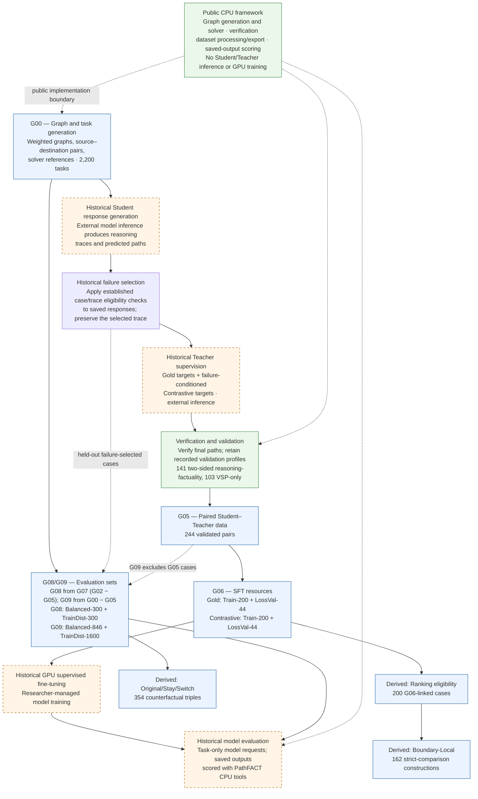

# PathFACT

**PathFACT: A Reusable Framework and Dataset for Failure-Informed LLM Shortest-Path Reasoning**

[**Get the PathFACT dataset on Hugging Face**](https://huggingface.co/datasets/MinervaCYY/PathFACT) — the v0.1 release contains 10 Core and 3 Derived JSONL resources.

## 1. What is PathFACT?

Weighted shortest-path problems have exact, solver-verifiable answers, yet a language model can produce an invalid route or a feasible route that is not minimum-cost. PathFACT uses authentic Student failures and validated Teacher supervision to build reusable training and evaluation resources, and to investigate what models learn from different forms of supervision.

PathFACT is the framework, dataset suite, and empirical investigation together. Its goal is to make failure-informed shortest-path research inspectable and reusable.

## 2. PathFACT Research Workflow



The dataset branch follows weighted task generation through verified Student failures and the paired Gold/Contrastive Teacher targets. G06 freezes the matched SFT examples. G08/G09 are separately constructed evaluation populations; they are not outputs of model training. Original/Stay/Switch triples derive from G09, while ranking eligibility and Boundary-Local resources relate to G06 Train cases. The public CPU package handles graph, solver, data, verification, and saved-output scoring operations; historical Student/Teacher generation, model training, and new model inference require researcher-managed model environments.

The 141 G05 pairs with two-sided reasoning-factuality profiles and 103 pairs with final-path checks only remain distinct. A verified final path does not certify every sentence in the associated reasoning text.

[**Browse all 13 released datasets on Hugging Face**](https://huggingface.co/datasets/MinervaCYY/PathFACT).

## 3. What PathFACT Provides (C1 framework, C2 dataset suite)

**C1 — Framework.** The public Python 3.12+ CPU package supports configurable graph/task generation, shortest-path solving and route verification, validated data processing, construction of derived dataset resources, and offline scoring of saved predictions. See the CLI below and [Offline Evaluation](docs/EVALUATION.md) for the actual interfaces and scoring limits.

The package does not run model inference, GPU training, or model-dependent candidate-path likelihood scoring. Researchers provide those environments and their own predictions. The CPU package does not automatically reproduce historical model-dependent experiments.

**C2 — Dataset suite.** The public v0.1 suite is an independent research resource, not merely example output from the package. It contains **10 Core JSONL resources** and **3 Derived JSONL resources**. Core includes 2,200 standalone tasks, 244 paired Student-failure/Teacher-target records, four frozen G06 training files, and four overlapping G08/G09 evaluation views. Derived includes 354 controlled Original/Stay/Switch triples, 200 ranking-eligibility records, and 162 boundary-local constructions. Counts and relationships are detailed in the [Dataset Map](DATASET_MAP.md); field names and caveats are in the [Data Dictionary](DATA_DICTIONARY.md).

The four evaluation views contain 3,046 row memberships but 1,859 unique cases; overlapping views are not independent replications. Keep each record's `reference` out of model input. The Derived resources contain no model responses or learned preference scores.

## 4. What Do We Investigate? (C3)

The empirical investigation compares four conditions: **Base** (no task-specific SFT), **Vanilla-SFT** (answer-only supervised fine-tuning), **LIMO** (ordinary Teacher-reasoning SFT), and **ContrastiveLIMO** (failure-conditioned corrective SFT). These are distinct experimental conditions; the documentation makes no claim that one SFT method is universally superior.

The completed investigation addresses:

- Task-only shortest-path correctness, accepting any valid minimum-cost route.
- Case-level rescues and regressions between conditions.
- Checkpoint and training-recipe sensitivity.
- Route feasibility versus optimality.
- Controlled graph changes using Original, Stay, and Switch variants.
- Candidate-path preference versus autonomous generation.
- Training and generation costs.

These questions describe the scope of the empirical work, not guaranteed effects or universal conclusions. Evaluation policies and limits are documented in [Offline Evaluation](docs/EVALUATION.md).

## 5. Getting Started

PathFACT requires Python 3.12 or newer:

```bash
python3.12 -m venv .venv
source .venv/bin/activate
python -m pip install -e .
```

Inspect supported commands:

```bash
pathfact --help
pathfact path verify --help
pathfact dataset build-paired-sft --help
pathfact dataset export-public --help
pathfact dataset export-core-candidate --help
pathfact dataset export-derived-candidate --help
pathfact evaluate saved --help
```

For a worked dataset example and explanations of model inputs and references, see [Getting Started](GETTING_STARTED.md). Dataset builders consume records supplied by the researcher; the saved-prediction evaluator consumes already extracted candidate paths.

## 6. Repository and Dataset Guides

- [Getting Started](GETTING_STARTED.md): shortest-path records, workflow, and first-record example.
- [Dataset Map](DATASET_MAP.md): all 13 released files, counts, relationships, and evaluation overlap.
- [Data Dictionary](DATA_DICTIONARY.md): original JSON keys, field meanings, and validation caveats.
- [Offline Evaluation](docs/EVALUATION.md): prediction inputs, scoring policies, outputs, and limits.
- [Source Provenance](docs/SOURCE_PROVENANCE.md): verified source history and reproducibility evidence.
- [Dataset Licensing](docs/DATASET_LICENSE.md): dataset scope and exclusions.
- [Hugging Face Dataset Card](https://huggingface.co/datasets/MinervaCYY/PathFACT): release files, configurations, and dataset licensing disclosures.

## 7. Reproducibility, Availability and Licensing

The fixed scientific dataset release is [PathFACT v0.1 at revision `3d20d452e1efe21c80d55185f5176ca3fc5e4f9f`](https://huggingface.co/datasets/MinervaCYY/PathFACT/tree/3d20d452e1efe21c80d55185f5176ca3fc5e4f9f). Documentation changes after that release do not alter its scientific JSONL files. The public software is MIT licensed; the dataset's CC BY 4.0 scope applies only as described in the [Dataset Card](https://huggingface.co/datasets/MinervaCYY/PathFACT), including its third-party exclusions. Software licensing does not automatically grant rights to dataset content.

Historical source records and reproducibility evidence are described in [Source Provenance](docs/SOURCE_PROVENANCE.md). Reproducing model-dependent results requires the relevant checkpoints, inference/training setup, and saved outputs; these are not supplied or run by the public CPU package.
